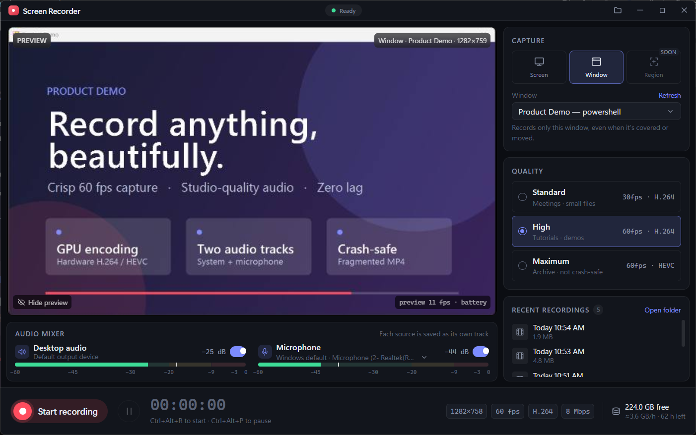
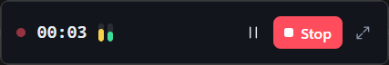

<div align="center">


# Screen Recorder

**Crisp, smooth, lag-free screen recording for Windows.**<br />
Record your screen or a single window in 60 fps, with clean audio, using your GPU, not your CPU.

<p>
  
  
  
  
  
  
  <a href="LICENSE"></a>
</p>

<p>
  <a href="#-features">Features</a> ·
  <a href="#-screenshots">Screenshots</a> ·
  <a href="#-installation">Installation</a> ·
  <a href="#-usage">Usage</a> ·
  <a href="#-building-from-source">Build</a> ·
  <a href="#-documentation">Docs</a> ·
  <a href="#-license">License</a>
</p>



</div>

---

## ✨ Features

|   | Feature | What you get |
|---|---|---|
| 🎥 | **Smooth 60 fps capture** | A steady frame rate with no dropped frames, at your screen's native resolution, with sharp text. |
| ⚡ | **GPU-powered, low CPU** | Capture, colour conversion and encoding run on your graphics card (Intel QuickSync, NVIDIA NVENC or AMD AMF). Recording uses about **2% CPU**. |
| 🪟 | **Screen or single window** | Record a whole display, or just one app window. Window recording keeps working when the window is covered or moved. |
| 🎙️ | **System audio + microphone** | Each saved as its **own audio track**, so you can adjust or mute either one later. Plug in a USB or Bluetooth mic and it appears instantly. |
| 🎚️ | **Live audio mixer** | dB level meters for every source, even before you start, so you can check your mic first. |
| 👀 | **Live preview** | A smooth preview of exactly what will be recorded. It never shows the app itself, and it can be switched off to save battery. |
| ⏸️ | **Pause and resume** | Pause as often as you like. The finished video has no gaps. |
| 🛡️ | **Crash-safe files** | Recordings are written so that a crash or power cut doesn't lose what you've already recorded. |
| 🎨 | **Accurate colours** | Correct BT.709 colour labels, so blacks stay black and recordings look the same in every player. |
| 🚀 | **Starts instantly** | Recording begins in about half a second after you press the hotkey. |
| 🧭 | **Out of your way** | While recording, the app shrinks to a small always-on-top control pill. It never appears in your videos. |
| 🗂️ | **Recent recordings** | Your latest videos, always in sync with the folder, even when files are changed in File Explorer. |

## 📸 Screenshots

<table>
  <tr>
    <td width="60%">
      
      <p align="center"><b>Studio</b>: preview, capture source, quality presets and audio mixer in one place.</p>
    </td>
    <td width="40%" valign="middle">
      
      <p align="center"><b>Recording pill</b>: timer, live audio meters, pause, stop, and a button to expand back to the studio.</p>
    </td>
  </tr>
</table>

## 📦 Installation

> **Requirements:** Windows 10 (version 2004 or newer) or Windows 11, and a graphics card with a hardware video encoder (almost every Intel, NVIDIA or AMD GPU from the last ten years).

1. Build the installer (see [Building from source](#-building-from-source)) or get `Screen Recorder_0.1.0_x64-setup.exe` from whoever shared it with you.
2. Double-click the installer. It installs for your user account only, so **no admin rights** are needed.
3. If Windows SmartScreen shows a warning, click **More info → Run anyway**. The installer isn't code-signed yet.

To uninstall, open **Settings → Apps → Installed apps → Screen Recorder → Uninstall**.

## 🎬 Usage

1. **Choose what to record**: **Screen** (pick a display) or **Window** (pick an app window).
2. **Pick a quality**:

   | Preset | Frame rate | Codec | Best for |
   |---|---|---|---|
   | Standard | 30 fps | H.264 | Meetings, long recordings, small files |
   | **High** (default) | 60 fps | H.264 | Tutorials and demos |
   | Maximum | 60 fps | HEVC | Archive and editing (not crash-safe) |

3. **Turn on audio**: desktop audio and/or your microphone. Watch the meters move to check them.
4. Press **Start recording** or **Ctrl + Alt + R**. The window shrinks to a small pill.
5. Press **Stop** or **Ctrl + Alt + R** again. A notification lets you **Play** the video or **Show it in the folder**.

Recordings are saved to **`Videos\Recordings`** as MP4 files, for example `Recording_2026-11-21_14-32-05.mp4`.

### ⌨️ Keyboard shortcuts

| Shortcut | Action |
|---|---|
| <kbd>Ctrl</kbd> + <kbd>Alt</kbd> + <kbd>R</kbd> | Start / stop recording (works from any app) |
| <kbd>Ctrl</kbd> + <kbd>Alt</kbd> + <kbd>P</kbd> | Pause / resume |
| <kbd>Esc</kbd> | Hide the studio to the system tray |

### 💡 Good to know

- **Tray icon:** grey means ready, red means recording, amber means paused. Click it to open the studio, or to stop while recording.
- **Window recording:** if the window you're recording is closed, the recording stops and is saved automatically.
- **Settings are remembered** between launches, including your display, window, quality and microphone.
- **Battery:** the preview slows down on battery. Click **Hide preview** to save even more. Recording quality doesn't change.

## 🛠️ How it works

```
 Screen / window ──► GPU capture ──► GPU colour conversion ──► Hardware encoder ──► MP4
 (Windows.Graphics.Capture)          (Direct3D 11)            (QuickSync / NVENC / AMF)
 System audio + mic ──► WASAPI ──► one AAC track per source ────────────────────────┘
```

Frames stay on the graphics card from capture to file, and a shared media clock keeps audio and video in sync. The engine is written in **Rust**; the interface uses **Tauri 2** and **Svelte 5**. More detail is in [docs/ARCHITECTURE.md](docs/ARCHITECTURE.md).

## 🧑‍💻 Building from source

**You need:** [Rust](https://rustup.rs) (MSVC toolchain), Visual Studio Build Tools with the *Desktop development with C++* workload, and [Node.js](https://nodejs.org) LTS.

```powershell
git clone https://github.com/DilshanRanabahu/screen-recorder.git
cd screen-recorder
npm install

npm run tauri dev       # run the app with hot reload
npm run tauri build     # build the installer → target\release\bundle\nsis\
cargo test --workspace  # run the tests
```

The first build takes a while (15–20 minutes on a laptop); later builds are quick.

<details>
<summary><b>Project layout and developer tips</b></summary>

```
crates/recorder-core/   Recording engine (capture, encoding, audio). No UI.
src-tauri/              Desktop app: commands, settings, tray, hotkeys, folder and device watchers
src/                    Svelte interface (components/, lib/api.ts, app.css)
docs/                   Design and architecture documents
```

- Record from the command line (engine only): `cargo run --release -p recorder-core --example record -- 5 high`
- Logs are in `%APPDATA%\ScreenRecorder\logs`.
- The app hides itself from screen captures. To take screenshots of it, start it with `SR_SHOW_IN_CAPTURE=1`.

</details>

## 📚 Documentation

| Document | What's inside |
|---|---|
| [Architecture](docs/ARCHITECTURE.md) | The capture → encode → file pipeline, threads, A/V sync, known issues |
| [UI design](docs/UI-DESIGN.md) | Design research, every screen, colours, preview and window capture details |
| [Features & roadmap](docs/FEATURES.md) | What's done and what's next |
| [Recording settings](docs/RECORDING-SETTINGS.md) | Codecs, bitrates, presets, colour accuracy |
| [Optimization](docs/OPTIMIZATION.md) | Measured performance and what was (and wasn't) optimized |
| [Tech stack](docs/TECH-STACK.md) | Why Rust + Tauri, and the libraries used |

## 🗺️ Roadmap

- [x] Screen and window recording, 60 fps, hardware encoding
- [x] System audio + microphone as separate tracks, plug-and-play mics
- [x] Pause/resume, crash-safe files, live preview, studio UI
- [ ] Region capture (drag a box to record part of the screen)
- [ ] Settings window: output folder, custom hotkeys, countdown
- [ ] Webcam overlay, click highlights, quick trim

See [docs/FEATURES.md](docs/FEATURES.md) for the full list.

## 📄 License

Released under the [MIT License](LICENSE). You're free to use, modify and share it, including commercially, as long as the copyright notice is kept.

<div align="center">
<br />
<sub>Built with Rust 🦀 and Tauri for Windows.</sub>
</div>
